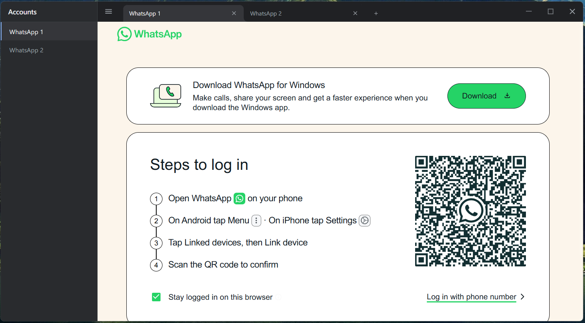

# Multi-Claude

**A desktop application for managing and using multiple Claude accounts simultaneously in a single window, with isolated sessions.**

<p align="center">
  
</p>

---

## ⟡ Features

* **▣ Multiple Claude Accounts** — Use multiple Claude accounts from a single application.
* **◈ Isolated Sessions** — Each account maintains its own independent session and authentication state.
* **▤ Multi-Tab Interface** — Manage multiple Claude sessions through a convenient tab-based interface.
* **◫ Session Persistence** — Account sessions remain available after restarting the application.
* **✦ Custom Tab Names** — Rename tabs to easily identify different Claude accounts.
* **◉ Tab Customization** — Organize accounts with customizable tab appearance.
* **⇄ Quick Account Switching** — Switch between Claude accounts without opening separate browser windows.
* **▣ Desktop Application** — A dedicated desktop experience instead of managing multiple browser profiles manually.

---

## ⌘ Getting Started

### ⟐ Requirements

* **Windows**
* **Node.js**
* **npm**

### ⟐ Installation

Clone the repository:

```bash
git clone https://github.com/helptool/Multi-Claude.git
cd Multi-Claude
```

Install dependencies:

```bash
npm install
```

Start the application:

```bash
npm start
```

---

## ⚒ Build

Create a production build with:

```bash
npm run make
```

The generated build files will be available inside the project's `out` directory.

---

## ◇ Use Case

Multi-Claude is designed for users who need to work with **multiple Claude accounts** while keeping their sessions separated and easily accessible.

Instead of maintaining multiple browser windows or profiles, Multi-Claude provides a **single desktop workspace** for managing multiple Claude sessions.

---

## ⓘ Disclaimer

Multi-Claude is an independent third-party project and is **not affiliated with, endorsed by, or sponsored by Anthropic**.

Claude and Anthropic are trademarks of their respective owners.

---

## ◉ License

This project is licensed under the **MIT License**.
